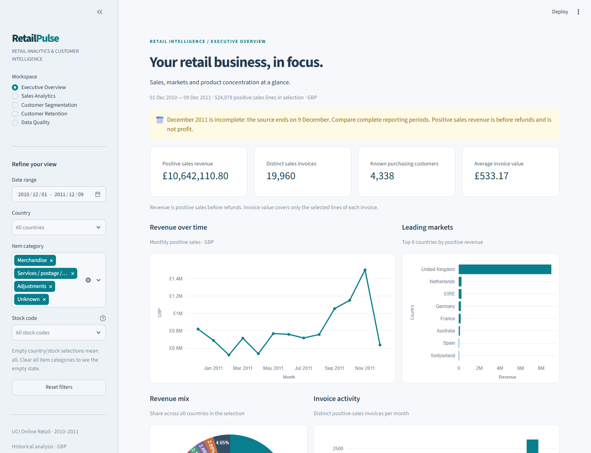
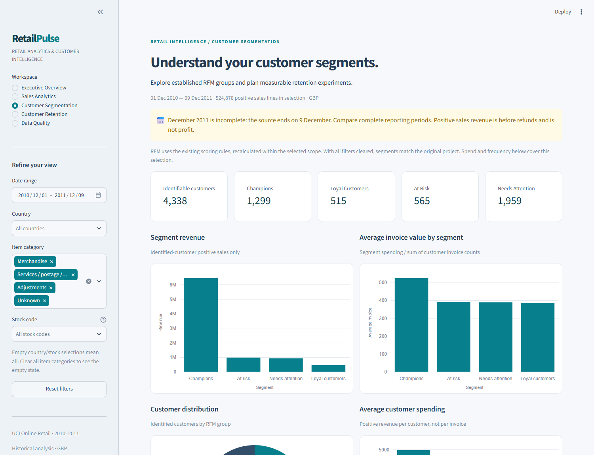
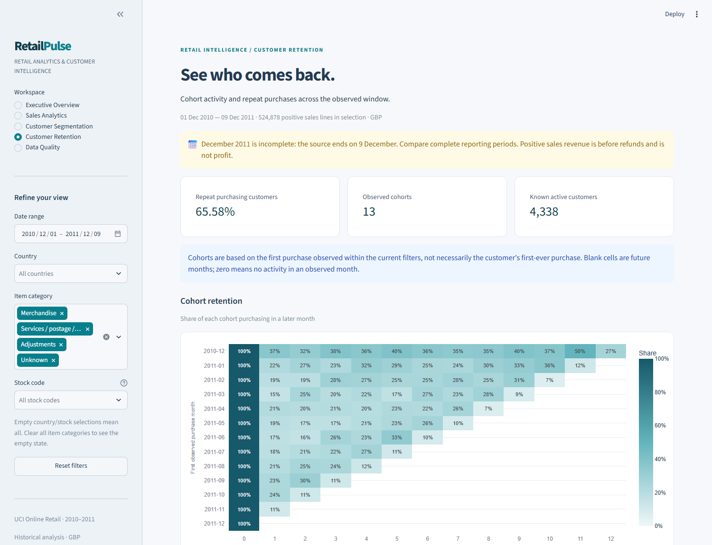
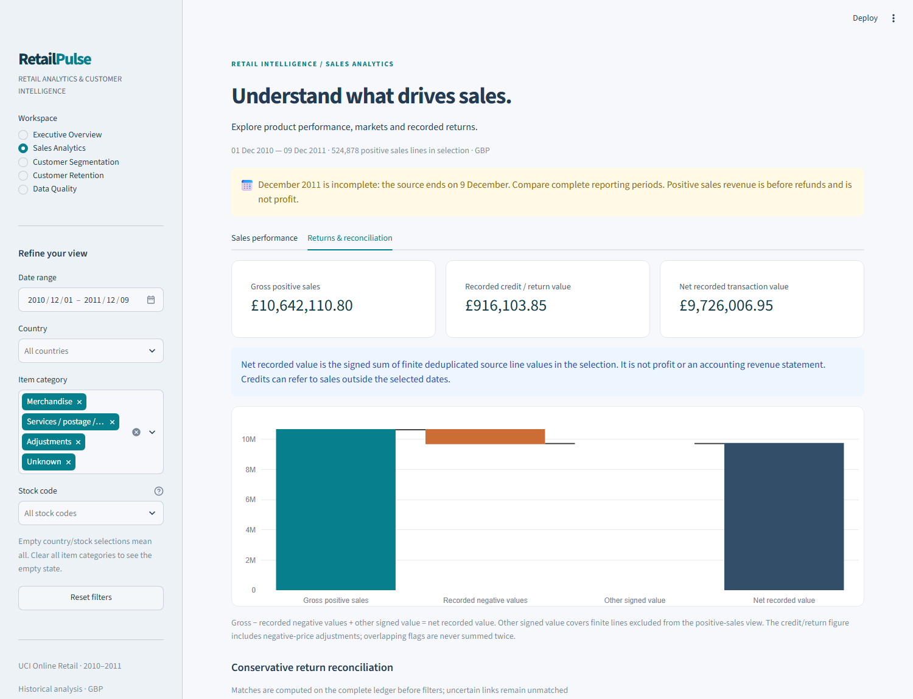
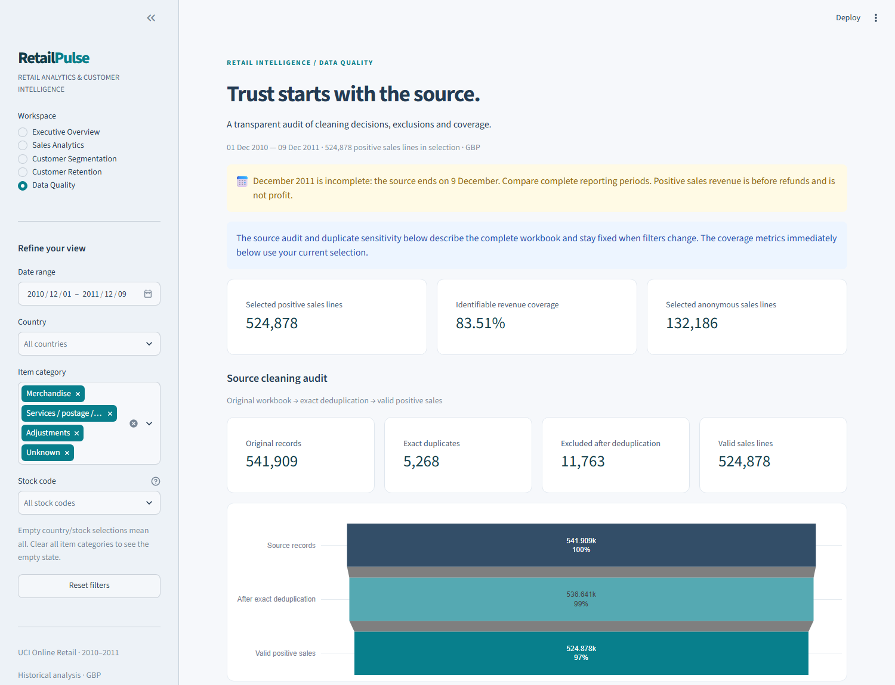
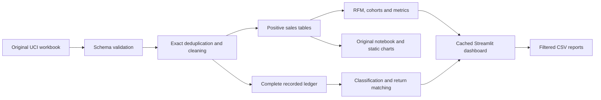

# RetailPulse ? End-to-End Retail Analytics & Customer Intelligence

Explore **541,909 retail transaction records** through a five-page interactive dashboard, with transparent cleaning, customer intelligence and recorded-return reconciliation.

**524,878 valid sales lines ? ?10.64m positive sales before refunds ? 19,960 invoices ? 4,338 known customers**

Built by extending the existing Online Retail EDA. The original pipeline, executed notebook, 11 static charts, six CSV outputs and established RFM methodology are preserved.

## Features

- **Interactive Streamlit dashboard:** Executive Overview, Sales Analytics, Customer Segmentation, Customer Retention and Data Quality.
- **Shared filters:** inclusive date range, country, stock code and item category; scoped KPIs, Plotly charts and CSV downloads.
- **Automated cleaning:** source validation, recoverable downloads, exact deduplication and an auditable positive-sales view.
- **Customer intelligence:** existing RFM scores, four segments, spending and invoice-value comparisons, segment explorer and customer exports.
- **Cohort retention:** first-observed purchase cohorts, monthly customer activity, cohort sizes and repeat purchasing.
- **Product and geographic analytics:** stock-code rankings, country contribution, merchandise/service classification and Pareto concentration.
- **Returns analysis:** separate gross sales, negative recorded values and signed transaction total; conservative matches and explicit unmatched reasons.
- **Quality reporting:** cleaning funnel, overlapping conditions, identifiable revenue coverage and duplicate sensitivity.
- **Validation:** analytical regression tests, Streamlit interaction tests, browser checks and real-data reconciliation.

## Live Demo

**[Open the live RetailPulse dashboard](https://retailpulse-9k5rdvrfmitcp7jzfsxae8.streamlit.app/)**

Deployed on Streamlit Community Cloud. All five views and the original headline metrics were verified in a public browser session on 12 November 2026.

## Dashboard Screenshots

Actual screenshots captured from the running application using the UCI workbook:



| Customer intelligence | Retention |
|---|---|
|  |  |

| Sales and returns | Data quality |
|---|---|
|  |  |

Additional [sales](assets/screenshots/sales-analytics.png), [filtered-country](assets/screenshots/filtered-france.png) and [mobile](assets/screenshots/mobile.png) captures are included.

## Dataset Information

**UCI Machine Learning Repository ? Online Retail.**

Chen, D. (2015). *Online Retail* [Dataset]. UCI Machine Learning Repository. [DOI: 10.24432/C5BW33](https://doi.org/10.24432/C5BW33). Dataset license: **CC BY 4.0**.

- UK-based online retailer; records cover **1 December 2010?9 December 2011**.
- Fields: invoice number, stock code, description, quantity, invoice timestamp, unit price, customer ID and country.
- December 2011 has only nine observed days. Customer IDs can be missing; refunds may refer to purchases before the observation window.
- No costs, margins, marketing campaign outcomes or proven first-ever customer acquisition dates are available.

The app downloads the [official UCI archive](https://archive.ics.uci.edu/static/public/352/online+retail.zip) on first use. For offline setup, extract `Online Retail.xlsx` into `dataset/`. Raw data is never overwritten. Source and large generated tables are Git-ignored; no fabricated demo data is substituted.

## Technology Stack

| Layer | Tools |
|---|---|
| Runtime and analytics | Python 3.12, Pandas, NumPy |
| Interactive application | Streamlit, Plotly |
| Original EDA and charts | Jupyter, Matplotlib, Seaborn |
| Workbook input | OpenPyXL, urllib, zipfile |
| Validation | unittest, Streamlit AppTest, nbformat, nbclient; optional Playwright browser checks |
| Reproducibility and deployment | Virtual environment, universal dependency lock, GitHub Actions, Streamlit config, Dockerfile |

`requirements-app.txt` contains dashboard runtime dependencies. `requirements.txt` adds notebook tools. `requirements-lock.txt` pins the tested full stack with operating-system markers. `requirements-dev.txt` adds optional browser capture tools. ReportLab/pypdf used by the earlier PDF walkthrough remain optional report utilities.

## Project Architecture

```text
Python-EDA-Project/
??? streamlit_app.py             # Dashboard entry point
??? dashboard/
?   ??? ui.py                    # Shared filters, theme and cached initialization
?   ??? pages.py                 # Five presentation views
?   ??? charts.py                # Reusable Plotly chart styling
??? src/
?   ??? data_cleaning.py         # Preserved original EDA pipeline
?   ??? analytics.py             # Pure filtering, aggregation and segment reports
?   ??? classification.py        # Explainable stock/category rules
?   ??? finance.py               # Recorded values, returns and duplicate sensitivity
?   ??? reporting.py             # Load once; export extended analytical reports
??? notebooks/online_retail_analysis.ipynb
??? dataset/                     # Source workbook and generated tables; Git-ignored
??? visualizations/              # Original 11 generated PNGs; Git-ignored
??? assets/screenshots/          # Genuine running-app captures
??? tests/                       # Original + analytics + dashboard tests
??? scripts/                     # PDF, screenshots, end-to-end validation, result checks
??? docs/                        # Methodology, deployment and validation details
??? .streamlit/config.toml
??? .github/workflows/ci.yml
??? analysis_summary.json        # Original computed summary; Git-ignored
??? Python_EDA_Project_Walkthrough.pdf  # Earlier core-EDA milestone walkthrough
??? requirements*.txt
??? Dockerfile
??? LICENSE
```



Presentation functions are separate from pure analytical calculations. The app caches a shared read-only bundle keyed by workbook path, size and modification time. Filtered views are copies; interactions do not re-read the workbook. First initialization may take a minute or more.

## Key Business Insights

| Verified metric | Result |
|---|---:|
| Source transaction lines | 541,909 |
| Exact duplicates removed | 5,268 |
| Valid positive sales lines | 524,878 |
| Gross positive sales before refunds | ?10,642,110.80 |
| Distinct sales invoices | 19,960 |
| Known purchasing customers | 4,338 |
| Average selected sales invoice value, unfiltered | ?533.17 |
| Recorded negative value, including adjustments | ?916,103.85 |
| Net recorded transaction value | ?9,726,006.95 |
| Merchandise-classified positive sales | ?10,246,820.87 |
| Other categories' positive sales, including Unknown | ?395,289.93 |
| Known-customer positive revenue coverage | 83.51% |
| Repeat purchase share among known customers | 65.58% |

- **UK concentration:** 84.59% of positive sales comes from the United Kingdom. Investigate UK operations first; this alone does not prove a growth strategy.
- **Product concentration:** 803 of 3,922 stock codes (20.47%) account for at least 80% of positive revenue. Review availability after separating service charges and exceptional orders.
- **Service-code caveat:** the largest revenue code is DOTCOM POSTAGE, not a merchandise product. Unfiltered rankings must not be described as merchandise bestsellers.
- **Observed peak:** November 2011 has ?1,503,866.78 in positive sales. December 2011 is partial and cannot establish a full-month decline.
- **Customer concentration:** 1,299 Champions contribute about 72.77% of identified-customer positive revenue. Segment experiments should be evaluated with new campaign data, not assumed effective.
- **Return evidence:** 4,802 return/adjustment records match a unique earlier sales line under conservative rules; 5,787 remain unmatched. Matching is candidate linkage, not proof of original invoice reference.
- **Duplicate sensitivity:** retaining exact duplicates produces 530,104 valid sales lines and ?10,666,684.54 positive sales, ?24,573.74 above the default. Default metrics are unchanged.

## Installation

### Windows PowerShell

```powershell
py -3.12 -m venv .venv
.venv\Scripts\Activate.ps1
python -m pip install -r requirements-lock.txt
```

### macOS / Linux

```bash
python3.12 -m venv .venv
source .venv/bin/activate
python -m pip install -r requirements-lock.txt
```

Existing project environment: keep `.venv` and install into it. In VS Code, select that environment for Python and the notebook kernel. For a lighter dashboard install, use `requirements-app.txt` instead of the full lock file. Optional browser checks require `requirements-dev.txt` and `python -m playwright install chromium`.

## Running the Dashboard

From the repository root:

```bash
python -m streamlit run streamlit_app.py
```

Open the local address printed by Streamlit, normally `http://localhost:8501`.

To regenerate analytical outputs independently:

```bash
python src/data_cleaning.py
python -m src.reporting
```

The first command preserves the original six CSVs and 11 PNG charts. The second adds `segment_summary.csv`, `return_matches.csv`, `duplicate_sensitivity.csv`, `category_revenue.csv`, `product_classification.csv` and `financial_summary.json` under `dataset/`.

## Running Tests

```bash
python -m unittest discover -s tests -v
python -m pip check
python scripts/verify_results.py     # After both output pipelines above
```

For the complete local validation (tests, dependency check, original pipeline, notebook execution, extended reports and reconciliations):

```bash
python scripts/validate_project.py
```

All **30 tests passed locally**, and all 11 existing notebook code cells were re-executed successfully. Real-browser checks also passed for the five views, four CSV downloads, country filtering and mobile overflow. Synthetic fixtures exist only inside tests. The dashboard always loads the real workbook. GitHub Actions is configured for push/PR tests and import checks. A manual workflow also runs network-dependent real-data checks. See [GitHub Actions](https://github.com/AshwinGaikwad-Git/RetailPulse/actions) for the current remote CI status.

## Methodology

- **Cleaning:** preserve raw data; deduplicate exact records; exclude credit notes, non-positive quantities/prices, invalid dates/identifiers and nonfinite sales values. Anonymous customer IDs remain in sales and are never imputed.
- **Revenue:** gross positive sales retains the established methodology. Recorded negative value counts each finite negative line once. Net recorded value sums signed finite deduplicated line values. Gross minus negatives plus a clearly shown residual reconciles to net. None is profit.
- **Classification:** explicit code/description rules separate services and adjustments. Regular catalog-code patterns are merchandise candidates; ambiguous codes remain Unknown. No classified row is silently dropped.
- **Returns:** require an observed customer, exact stock code and price, a strictly earlier unique sales-line candidate, and sufficient remaining quantity. Matched units are consumed once. Missing, ambiguous or oversized links remain unmatched with reasons.
- **RFM:** reference date is the day after the latest valid selected purchase. Frequency counts distinct invoices; Monetary sums selected positive sales. Average percentile ranks map to four scores; Recency is reversed. Existing priority rules and full-data segment counts remain unchanged.
- **Cohorts:** first observed purchase month within scope; subsequent active customers divided by cohort size. Observed inactive months are zero; future months stay blank. These are not proven acquisition dates or churn predictions.
- **Filters:** all operating KPIs use the selected scope. Product-filtered invoice values represent selected lines only. RFM and cohorts are recalculated within the selection. The source quality audit is explicitly global; its coverage cards are filtered.
- **Boundary periods:** December 2011 ends on the ninth; date filters can truncate other months. Do not claim recurring seasonality from this single observation window.

See [full methodology](docs/methodology.md), [deployment guide](docs/deployment.md), and [validation report](docs/validation.md) for exact scope, matching rules and evidence.

## Deployment

The app is prepared for Streamlit Community Cloud with `streamlit_app.py`, root dependencies and `.streamlit/config.toml`. Choose Python 3.12 and allow the first-run UCI download. The [live application](https://retailpulse-9k5rdvrfmitcp7jzfsxae8.streamlit.app/) has been verified. Review [deployment steps](docs/deployment.md) for configuration and maintenance.

A Dockerfile is supplied as an alternative. Container execution requires Docker and is separately identified as unverified if Docker is unavailable locally.

## Limitations and Future Enhancements

Implemented: five dashboard views, exports, documented classifications, conservative return matching, duplicate sensitivity, tests and deployment configuration.

Remaining:

1. Refine Unknown classifications with retailer documentation and assess non-merchandise accounting treatment.
2. Improve matching only when stronger original-invoice evidence exists; never infer all credits have an in-window sale.
3. Validate a hosted deployment's cold-start time and memory use; no hosted performance claim is made.
4. Add later periods and external cost/campaign evidence before profit analysis, lifetime value, forecasting or campaign-effectiveness claims.
5. Consider columnar storage or a database for substantially larger datasets.

Source customer identifiers are pseudonymous, not names or contact details. Do not treat pseudonymity as proof of formal anonymization.

## License

Project code is released under the [MIT License](LICENSE). No pre-existing license file was found. The UCI dataset is separately licensed **CC BY 4.0**, attributed to Chen (2015); the software license does not relicense third-party data or dependencies.
